# 🏡 Marie S. Interiors

### ✨ Inspired Spaces. Thoughtful Details. Beautiful Living.

Welcome to **Marie S. Interiors**, an interior design experience created to bring creativity, inspiration, and organization together in one place.

From exploring beautiful spaces to creating personalized room concepts, this application allows users to bring their design ideas to life through curated colors, materials, furniture inspiration, and project planning.

## 🌿 About the Project

Marie S. Interiors is a modern interior design web application built with React. The overall aesthetic is inspired by luxury interiors, natural textures, warm neutrals, soft color palettes, and timeless design.

The goal is to create a space where design inspiration meets functionality, making it easier to explore ideas and organize interior design projects.

## 🛋️ Features

- 🏠 **Home Page** – A welcoming introduction to the Marie S. Interiors brand.
- 🌸 **Inspiration** – Explore interior design ideas and visual inspiration using photos from Unsplash.
- 📁 **Projects** – Browse design projects and keep track of individual spaces.
- 📝 **Project Details** – View project overviews, timelines, current selections, and designer notes.
- 🎨 **Room Designer** – Create room concepts using curated color palettes, fabric textures, wood finishes, and furniture inspiration.
- 🧺 **Saved Materials** – Keep track of favorite design materials and selections.
- 💾 **Saved Designs** – Save room design ideas for future reference.
- 📱 **Responsive Design** – Enjoy a clean and organized browsing experience.

## 🧭 Available Routes

The application uses React Router DOM for navigation between pages.

| Route | Description |
|---|---|
| `/` | Main Home Page |
| `/inspiration` | Browse interior design inspiration |
| `/projects` | View available design projects |
| `/projects/:projectId` | View details for an individual project |
| `/room-designer` | Create and organize personalized room designs |
| `*` | Displays the Not Found page for unrecognized routes |

The Projects and Room Designer pages use a sidebar layout, while the other pages use the main navigation header.

## 📸 Application Screenshots

Here are screenshots showcasing the different pages and features of Marie S. Interiors.

### 🏡 Home Page

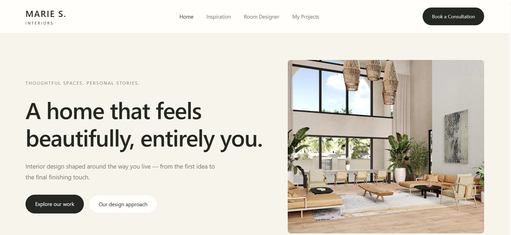

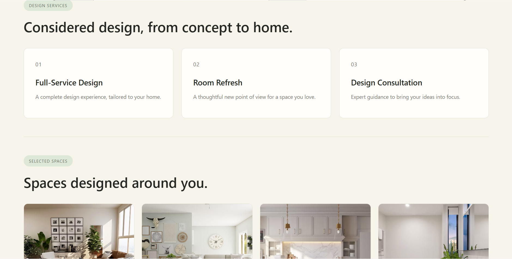

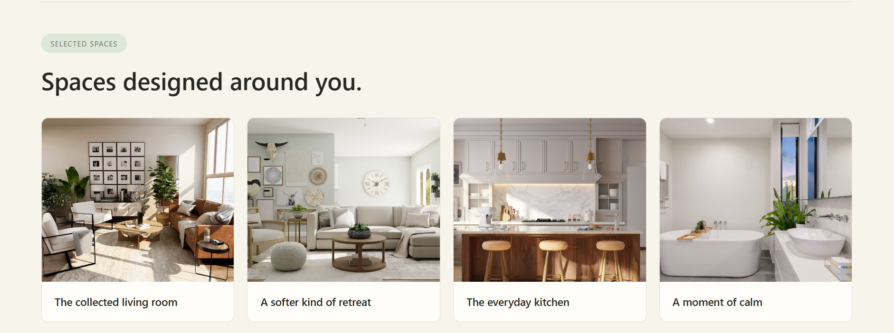

### 🌸 Inspiration Page

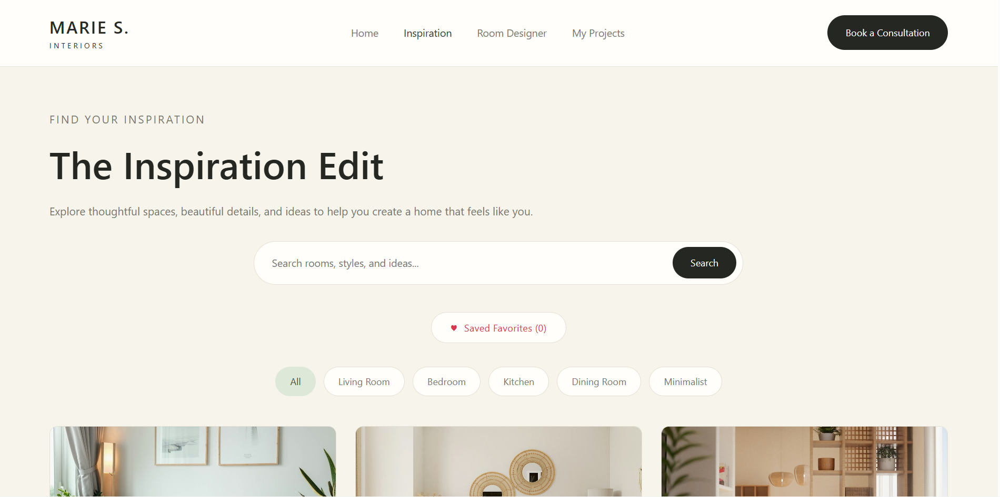

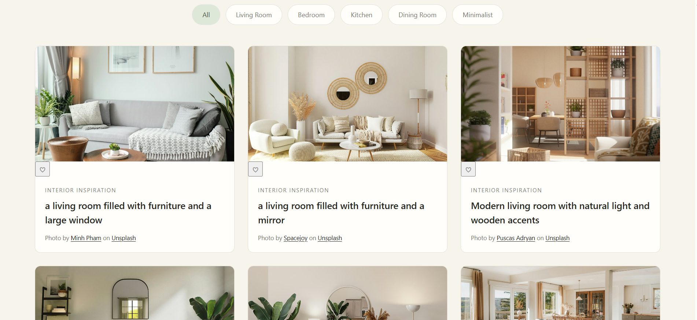

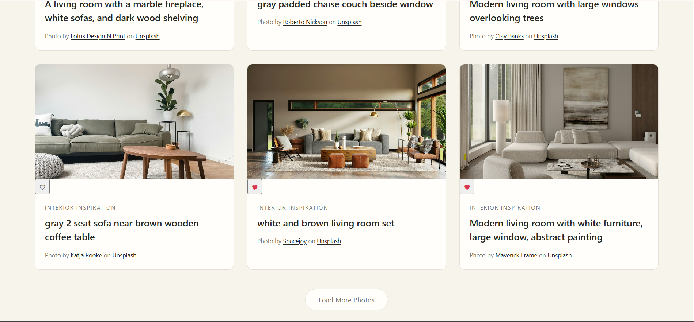

### 📁 Projects Page

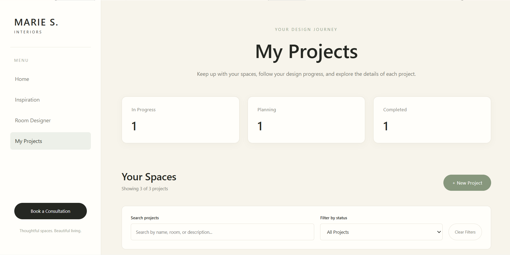

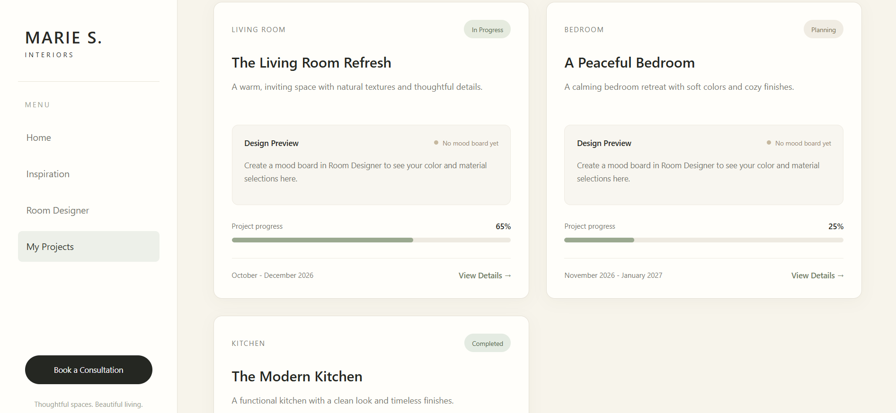

### 🛋️ Living Room Project

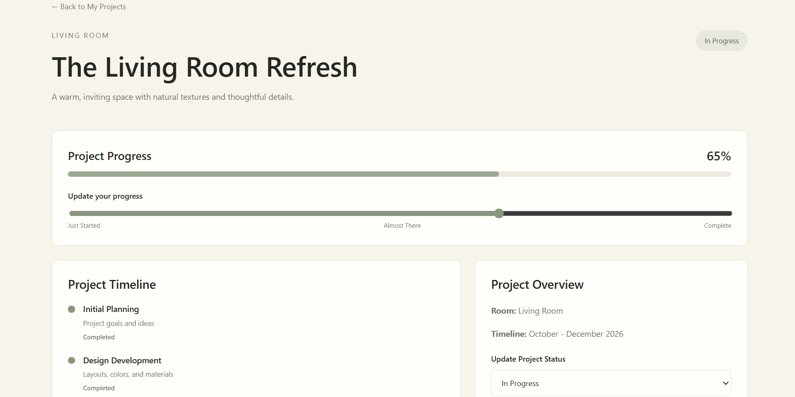

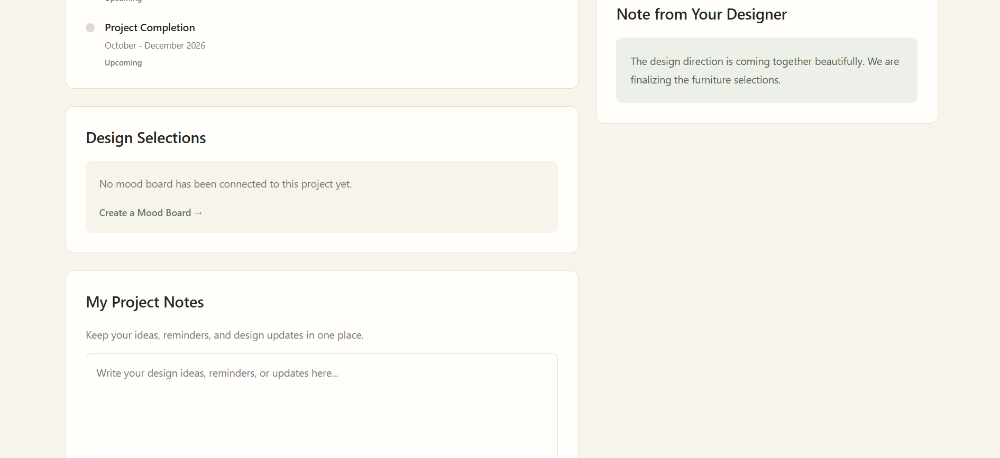

### 🎨 Room Designer

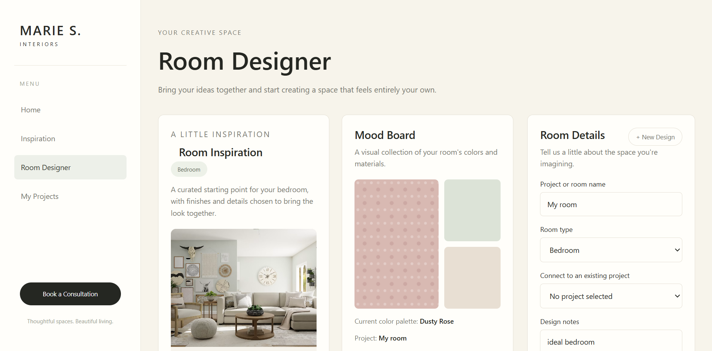

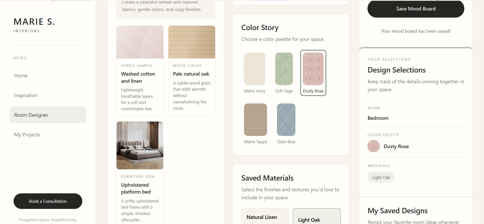

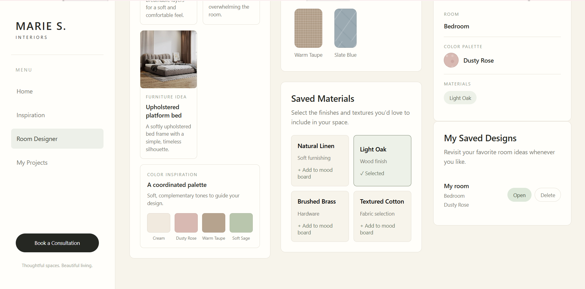

## 🤍 Design Aesthetic

The visual direction of Marie S. Interiors focuses on:

- Warm ivory and creamy neutrals
- Soft sage and muted tones
- Natural oak and wood finishes
- Linen and woven fabric textures
- Curated furniture inspiration
- Minimalist layouts with a luxury feel

## 💻 Technologies Used

### Frontend

- ⚛️ React
- JavaScript
- HTML5
- CSS3
- React Router DOM
- React Context API

### Development and Testing

- Vite
- Vitest
- React Testing Library
- Jest DOM
- ESLint

### External API

- Unsplash API – Retrieves interior design inspiration photography.

## 🔌 API Documentation

Marie S. Interiors integrates with the Unsplash API to retrieve interior design inspiration photos.

The application uses a server-side API endpoint to communicate with Unsplash and retrieve photos based on search terms.

### API Endpoint

**Request Method:** `GET`

**Endpoint:** `/api/search`

### Query Parameters

| Parameter | Description | Default |
|---|---|---|
| `query` | Search term for inspiration photos | `interior design` |
| `page` | Page number for photo results | `1` |

### Example Request

```text
/api/search?query=living%20room&page=1
```

### Successful Response

The API returns a JSON response containing:

- `photos` – An array of photo objects.
- `page` – The current page number.
- `totalPages` – The total number of available result pages.

Each photo object includes:

- Photo ID
- Image description
- Image URL
- Photographer name
- Photographer username
- Photographer profile URL
- Original photo URL

The API retrieves up to 12 photos per page.

### Error Handling

The API handles the following errors:

- **405 – Method Not Allowed:** Returned when a request uses a method other than GET.
- **500 – Internal Server Error:** Returned when the Unsplash API key is missing or an unexpected server error occurs.
- **Unsplash API Errors:** The endpoint returns an error response if Unsplash cannot retrieve the requested photos.

### Environment Variables

The API requires an Unsplash access key stored as a server-side environment variable.

```env
UNSPLASH_ACCESS_KEY=your_unsplash_access_key
```

The API key should never be committed to a public GitHub repository.

### External API Documentation

[Unsplash API Documentation](https://unsplash.com/documentation)

## 📂 Project Structure

```text
marie-s-interiors/
├── api/
│   └── search.js
├── public/
├── screenshots/
│   └── screenshots/
│       ├── home-page1.png
│       ├── home-page2.png
│       ├── home-page3.png
│       ├── inspiration-page1.png
│       ├── inspiration-page2.png
│       ├── inspiration-page3.png
│       ├── livingroomproject-page1.png
│       ├── livingroomproject-page2.png
│       ├── projects-page1.png
│       ├── projects-page2.png
│       ├── roomdesign-page1.png
│       ├── roomdesign-page2.png
│       └── roomdesign-page3.png
├── src/
│   ├── assets/
│   ├── components/
│   ├── contexts/
│   ├── pages/
│   └── test/
├── index.html
├── package.json
├── vite.config.js
└── README.md
```

## 🚀 Getting Started

To run the application locally:

**1. Clone the repository**

```bash
git clone https://github.com/sierraelery8/marie-s-interiors.git
```

**2. Navigate into the project folder**

```bash
cd marie-s-interiors
```

**3. Install dependencies**

```bash
npm install
```

**4. Configure environment variables**

Create the required environment configuration for your Unsplash API access key. For local development, configure the server-side variable according to your deployment setup.

```env
UNSPLASH_ACCESS_KEY=your_unsplash_access_key
```

Do not commit your actual API key.

**5. Start the development server**

```bash
npm run dev
```

Open the local URL provided in your terminal to view the application.

Note: The `/api/search` serverless endpoint requires a compatible serverless development environment and the configured Unsplash API key.

## 🧪 Testing

The application uses Vitest and React Testing Library to test page functionality and components.

Run the test suite:

```bash
npm run test
```

**Current testing results: 12 passing tests across 4 test files.** ✅

## 📦 Production Build

To create a production-ready build, run:

```bash
npm run build
```

Vite generates the production files inside the `dist` folder.

To preview the production build locally:

```bash
npm run preview
```

## 🌐 Deployment

The application is deployed using Vercel and connected to its GitHub repository.

**Live Application:**

https://marie-s-interiors-seven.vercel.app/

### Deployment Process

1. Push the latest project changes to the `main` branch on GitHub.
2. Vercel detects the new commit and starts a deployment.
3. Vercel builds the application using `npm run build`.
4. Once deployment succeeds, the updated application is available through the live URL.

The Unsplash API key must also be configured as an environment variable in Vercel for the inspiration feature to work in production.

## 🎯 Project Goals

Marie S. Interiors was created to combine the beauty of interior design with the functionality of a modern web application.

This project demonstrates the use of reusable React components, state management, routing, interactive features, external API integration, responsive styling, and application testing.

## ⚠️ Known Issues

- No major known issues are currently identified.
- Additional testing across different screen sizes, mobile devices, and browsers would help ensure a consistent user experience.

## 🌱 Future Enhancements

- Expand the room inspiration gallery with additional interior design styles.
- Add more furniture, fabric, and decor selections.
- Improve saved design features to make organizing projects easier.
- Continue refining mobile responsiveness and accessibility.
- Explore additional ways for users to customize and personalize their room concepts.

---

### 🤍 Marie S. Interiors

*Inspired Spaces. Thoughtful Details. Beautiful Living.* ✨
